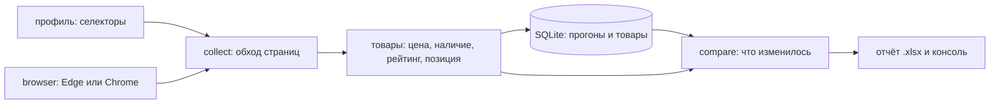

# shop-price-monitor — монитор цен и наличия в интернет-магазине

Инструмент открывает витрину магазина в настоящем браузере, собирает карточки товаров, складывает прогон в SQLite и показывает, что изменилось с прошлого раза: что подорожало и подешевело, что закончилось, что появилось и что пропало. Селекторы вынесены в профиль-файл, поэтому новый магазин добавляется JSON-ом, а не правкой кода.

```text
$ shop-monitor demo --out demo

Прогон 1 — как есть
  собрано товаров: 12

Прогон 2 — в магазине изменились цены и наличие
Локальная демо-витрина: http://127.0.0.1:53410/index.html
Собрано товаров: 12, страниц: 2
Изменений: 6
  • подешевел: Блендер погружной 800 Вт — 3 890,00 ₽ → 3 440,00 ₽ (−11,6%)
  • подорожал: Чайник электрический 1,7 л — 2 490,00 ₽ → 2 790,00 ₽ (+12,0%)
  • закончился: Микроволновая печь 20 л — нет в наличии, цена 7 990,00 ₽
  • снова в наличии: Сушилка для овощей — есть, 4 шт., цена 4 590,00 ₽
  • появился: Соковыжималка шнековая — 8 990,00 ₽, есть, 4 шт.
  • исчез: Термос 1 л — был по 1 590,00 ₽

Отчёт: demo\отчёт.xlsx
```

Команда `demo` поднимает локальную витрину, делает по ней два прогона (между ними в «магазине» меняются цены и наличие) и сохраняет отчёт. Интернет для этого не нужен — нужен только установленный браузер. Готовые файлы демо лежат в [`examples/`](examples).

## Что получается на выходе

| Лист отчёта | Содержимое |
|---|---|
| Изменения | что произошло, товар, было, стало, разница в рублях и процентах, наличие, ссылка. Подорожания подсвечены красным, подешевения — зелёным |
| Витрина | текущий срез: позиция, сдвиг позиции с прошлого прогона, цена, валюта, наличие, остаток, рейтинг, страница, ссылка |
| Прогоны | история: когда, по какому профилю, сколько товаров и страниц |

История хранится в SQLite, поэтому сравнивать можно не только с прошлым разом: в базе лежат все прогоны и все товары каждого из них.

## Как запустить

```bash
uv sync
uv run shop-monitor demo --out demo                  # локальная витрина, два прогона, отчёт
uv run shop-monitor profiles                         # встроенные профили и пример своего
uv run shop-monitor run --profile books --max-pages 2 -o отчёт.xlsx
uv run shop-monitor run --profile мой-магазин.json --db история.sqlite -o отчёт.xlsx --no-headless
uv run shop-monitor history --db история.sqlite
```

| Параметр `run` | Что делает |
|---|---|
| `--profile` | имя встроенного профиля (`books`) или путь к JSON-файлу с селекторами |
| `--db` | файл истории прогонов (по умолчанию `монитор.sqlite`) |
| `-o, --out` | сохранить отчёт в .xlsx |
| `--max-pages` | сколько страниц витрины обойти (по умолчанию 3) |
| `--pause` | пауза между страницами, секунд (по умолчанию 1) |
| `--browser` | `edge` или `chrome`; драйвер Selenium скачивает сам |
| `--no-headless` | показать окно браузера — удобно, когда селекторы не подходят |
| `--evidence` | куда положить снимок экрана и HTML, если карточки не нашлись |

Коды выхода: `0` — собрано, `1` — сбор или запись отчёта не удались, `2` — профиль не найден или браузер не запустился.

Профиль своего магазина — обычный JSON:

```json
{
  "name": "мой-магазин",
  "url": "https://shop.example/catalog/",
  "card": "div.product-card",
  "fields": {
    "name": {"selector": ".product-card__title"},
    "price": {"selector": ".product-card__price"},
    "availability": {"selector": ".product-card__stock", "optional": true},
    "rating": {"selector": ".rating", "attribute": "data-rating", "optional": true},
    "link": {"selector": "a.product-card__link", "attribute": "href", "optional": true}
  },
  "next_page": "a.pagination__next"
}
```

## Как устроено



| Модуль | Ответственность |
|---|---|
| `browser.py` | браузер на один прогон в контекстном менеджере; при сбое — снимок экрана и HTML страницы |
| `profiles.py` | профиль сайта: карточка, поля, пагинация; встроенные профили и проверка JSON с понятными ошибками |
| `collect.py` | ждёт появления карточек (`WebDriverWait`), собирает поля, идёт по «следующей странице», помнит пройденные адреса |
| `parsing.py` | цена, валюта, наличие, остаток, рейтинг из текста карточки — проверяется обычными тестами, без браузера |
| `storage.py` | SQLite: прогоны и их товары, поиск предыдущего прогона |
| `compare.py` | подорожал, подешевел, закончился, снова в наличии, появился, исчез, сдвиг позиции |
| `report.py` | Excel и консоль |
| `demo.py` | локальная витрина: HTML-страницы с задержкой отрисовки и сервер на localhost |

## Почему не Wildberries и не Ozon

Собирать карточки WB и Ozon браузером сегодня не получится, и дело не в селекторах:

- `wildberries.ru` на обычный запрос (даже за `robots.txt`) отвечает страницей антибот-проверки `__wbaas/challenges/antibot` с кодом 498 — проверено 12.09.2026;
- в `robots.txt` Ozon закрыт раздел `/search/` и часть карточных адресов.

Обходить защиту я не стал: это ровно то, от чего она поставлена. Поэтому сбор (браузер, карточки, выгрузка) работает туда, где автоматизация разрешена: на витрины интернет-магазинов и на учебные площадки. Встроенный профиль — [books.toscrape.com](https://books.toscrape.com), витрина, специально созданная для тренировки парсеров. Для WB и Ozon в этом портфолио есть [соседний проект](../wb-reviews-report) — он берёт данные из публичных JSON-адресов, которые отвечают на обычные запросы.

## Как проверялось

- `ruff format`, `ruff check` (E, F, W, I, B, UP, S — bandit, C4, SIM, PT, RUF, DTZ) и `mypy --strict` — без замечаний.
- `pytest` — 46 тестов за 26 с:
  - разбор цен, наличия и рейтингов (в том числе «star-rating Three», «1.199,00 €», «осталось 3»);
  - профили: разбор JSON, понятные ошибки на каждую поломку, сохранение и обратное чтение;
  - сбор настоящим браузером по локальной витрине: порядок и позиции, ограничение страниц, пауза только между страницами, необязательное поле, отсутствие карточек (с сохранением снимка экрана), отсутствие обязательного поля;
  - история и сравнение: шесть видов изменений, сдвиг позиций, запись и чтение SQLite;
  - командная строка: демо-прогон с отчётом, свой профиль-файл, пустая история, неизвестный профиль.
- Демо (`shop-monitor demo`) выдаёт то, что показано выше.
- Живой прогон 12.09.2026 по [books.toscrape.com](https://books.toscrape.com): 32 товара с двух страниц за 6,7 с, цены разобраны как GBP (47,82 £), рейтинги из класса `star-rating Four` — 4, наличие «есть».

### Не проверялось

- На настоящих витринах российских магазинов профили не писались: встроенный профиль один — учебная витрина. Для своего магазина селекторы нужно подобрать и проверить самому (для этого есть `--no-headless` и `--evidence`).
- Бесконечная прокрутка и подгрузка «Показать ещё» не поддержаны: сейчас пагинация — только ссылка «следующая страница».
- Авторизация, корзина, регионы и валютные настройки магазина не трогаются.
- Прогон запускался только на Windows с Microsoft Edge 152. Chrome в коде есть, но на нём не проверялся.
- Устойчивость к большим витринам не мерилась: демо — 12 товаров, живой прогон — 32.

## Структура

```text
src/shop_monitor/   browser, profiles, collect, parsing, storage, compare, report, demo, cli
tests/              parsing, profiles, collect (браузер), storage+compare, cli+report
examples/           витрина демо-магазина, база прогонов, отчёт .xlsx
```
